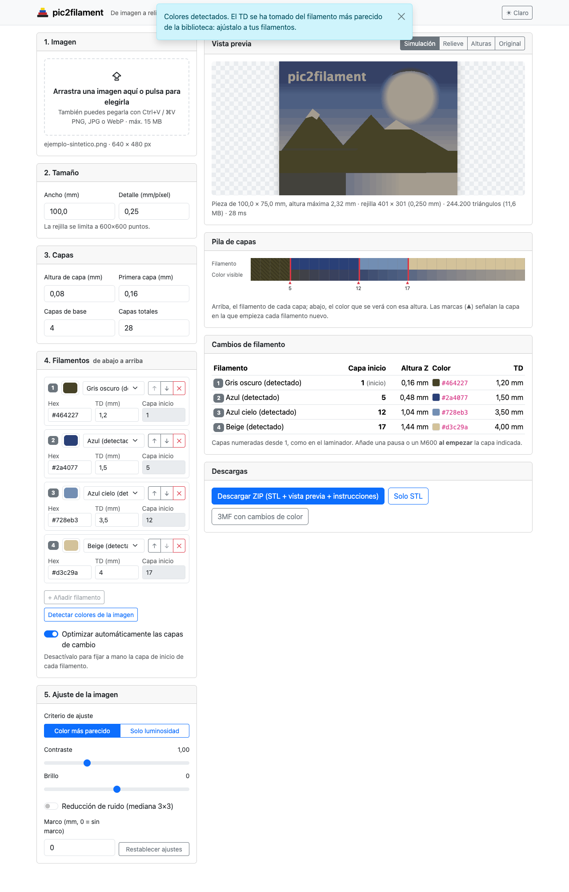
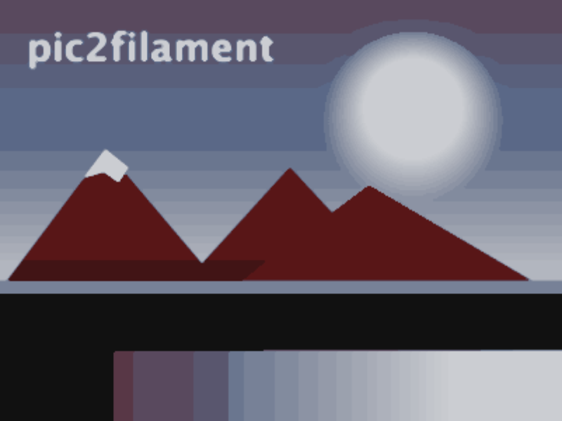

# pic2filament

Convierte cualquier imagen en un **relieve imprimible en 3D multicolor**, al estilo HueForge: subes una imagen, eliges de 2 a 4 filamentos y obtienes un **STL** y la lista exacta de **capas donde cambiar de filamento**.

La pieza se imprime tumbada con un solo extrusor. La altura de cada punto decide cuántas capas de cada filamento (semitransparentes) se apilan, y la mezcla de esas capas reproduce los tonos de la imagen.



Vista previa generada con la imagen de ejemplo y 4 filamentos (negro, rojo, azul cielo y blanco). Al ejecutar `./mvnw verify`, los resultados completos (STL, 3MF, vista previa e instrucciones) se generan en `ejemplo/salida/`, que no se versiona:



## Qué hace

1. **Subida de imagen**: PNG, JPG, WebP o **HEIC/HEIF** (las fotos del iPhone). Puedes arrastrarla, elegirla o pegarla con Ctrl+V. El límite es configurable (15 MB por defecto) y la transparencia se aplana sobre blanco.
2. **Ajustes**:
   - Tamaño: ancho en mm y detalle en mm por píxel. La rejilla se limita a 600×600.
   - Capas: altura de capa, altura de la primera capa, capas de base y capas totales.
   - Filamentos: de 2 a 4, ordenados de abajo a arriba. Cada uno tiene color, TD y capa de inicio. Hay una biblioteca editable de filamentos predefinidos.
   - **Detectar colores de la imagen**: usa k-means en CIELAB y ordena los colores de oscuro a claro.
   - Criterio de ajuste: *color más parecido* o *solo luminosidad*. También hay contraste, brillo y reducción de ruido (mediana 3×3).
   - Optimización automática de las capas de cambio, o capas fijadas a mano.
   - Marco opcional alrededor de la pieza.
3. **Vista previa** sin recargar la página, con cuatro modos: simulación de la pieza impresa, relieve sombreado, mapa de alturas y original. Incluye además la pila de capas con los puntos de cambio.
4. **Tabla de cambios de filamento**: filamento, capa de inicio (numerada desde 1, como en el laminador), altura Z, color y TD.
5. **Descargas**:
   - **Proyecto 3MF** listo para abrir en **Anycubic Slicer Next** o **Bambu Studio**: lleva la malla, el perfil de la impresora con la altura de capa, el relleno al 100 %, los colores y los cambios de filamento en su capa. Los cambios pueden ser automáticos (ACE Pro / AMS) o pausas M600.
   - **ZIP** con el STL binario, un PNG de la vista previa y un `.txt` con los ajustes del laminador y los cambios de color.
   - **Solo el STL**.

## Arrancar en local

### Con Maven Wrapper

Requiere Java 25. Para subir fotos **HEIC** hace falta un conversor: en macOS se usa `sips` (viene con el sistema); en Linux, instala libheif (`apt install libheif-examples` o `apk add libheif-tools`). La imagen Docker ya lo incluye.

```bash
./mvnw spring-boot:run
# o bien
./mvnw package && java -jar target/pic2filament.jar
```

Abre <http://localhost:8080>.

Pruebas completas (unitarias, de integración y de extremo a extremo):

```bash
./mvnw verify
```

### Con Docker Compose (recomendado para el servidor)

```bash
git clone https://github.com/mgarciat12/pic2filament.git
cd pic2filament
docker compose up -d --build
```

Para usar otro puerto en el host:

```bash
APP_PORT=9090 docker compose up -d --build
```

Para comprobar que está sano:

```bash
docker compose ps                            # STATUS debe mostrar "(healthy)"
curl http://localhost:8080/actuator/health   # {"status":"UP",...}
```

El contenedor se ejecuta con un usuario no root y tiene `HEALTHCHECK`, reinicio automático (`unless-stopped`) y un límite de memoria de 1 GB.

### Con Docker sin Compose

```bash
docker build -t pic2filament:latest .
docker run -d --name pic2filament -p 8080:8080 --restart unless-stopped pic2filament:latest
```

## Configuración

Todos los valores tienen un valor por defecto y se pueden cambiar con variables de entorno:

| Variable | Por defecto | Descripción |
|---|---|---|
| `PORT` | `8080` | Puerto HTTP dentro del proceso o contenedor |
| `APP_PORT` | `8080` | (solo en docker-compose) puerto publicado en el host |
| `MAX_UPLOAD_SIZE` | `15MB` | Tamaño máximo de la imagen subida |
| `MAX_REQUEST_SIZE` | `20MB` | Tamaño máximo de la petición multipart |
| `MAX_GRID` | `600` | Vértices máximos por lado de la rejilla |
| `MAX_IMAGE_MEGAPIXELS` | `60` | Límite de megapíxeles de la imagen decodificada |
| `MAX_TOTAL_LAYERS` | `300` | Capas totales máximas |
| `TEMP_DIR` | `${java.io.tmpdir}/pic2filament` | Directorio de ficheros temporales |
| `JOB_TTL` | `2h` | Tiempo sin uso tras el que se borra un trabajo |
| `MAX_JOBS` | `200` | Trabajos simultáneos como máximo (se borran los más antiguos) |
| `MAX_CONCURRENT` | `0` (= nº de CPU) | Conversiones simultáneas |
| `FILAMENTS_FILE` | *(vacío)* | Fichero YAML con tu biblioteca de filamentos |
| `PROFILES_DIR` | *(vacío)* | Directorio con perfiles de laminador propios para el proyecto 3MF |
| `DEFAULT_PROFILE` | `anycubic-kobra3-0.4` | Perfil seleccionado por defecto |
| `HEIF_COMMAND` | *(vacío = automático)* | Conversor de HEIC a PNG. Por defecto usa `heif-dec`, `heif-convert` o `sips`, el primero que encuentre. Puedes poner otro comando con `{entrada}` y `{salida}`, o `no` para desactivar HEIC |

No hay base de datos. Cada imagen subida se guarda en `TEMP_DIR/<id>/` y el resultado se mantiene en memoria. Una tarea periódica borra los trabajos caducados.

### Biblioteca de filamentos propia

Copia [`src/main/resources/filamentos.yml`](src/main/resources/filamentos.yml), añade tus filamentos y apunta a él:

```yaml
filamentos:
  - nombre: Mi PLA verde
    color: "#1f9a46"
    td: 2.1
```

En docker-compose, descomenta `FILAMENTS_FILE` y el volumen `./filamentos.yml:/config/filamentos.yml:ro`.

## Cómo usar el resultado en el laminador

### Opción recomendada: proyecto 3MF

Un **STL solo guarda la forma**: al abrirlo, el laminador no sabe nada de colores ni de cambios. Por eso pic2filament genera también un **proyecto 3MF** en el formato de Bambu Studio, que también leen Anycubic Slicer Next y OrcaSlicer. El proyecto incluye:

- la pieza centrada en la cama;
- el perfil de la impresora con **primera capa y altura de capa** de pic2filament, **relleno al 100 %** (zig-zag) y altura de capa adaptativa desactivada;
- los **colores** de los filamentos en las ranuras 1 a 4;
- los **cambios de filamento** en su capa, de una de estas dos formas:
  - **Automático**: cambio de herramienta a la ranura del filamento (`T1`, `T2`… con el **ACE Pro** de Anycubic, o cambio de **AMS** en Bambu). La vista previa del laminador muestra los colores. Carga los filamentos en las ranuras 1, 2, 3 y 4 en el mismo orden que en pic2filament.
  - **Manual (pausa)**: la impresora se pausa (`M600` en la Kobra 3; pausa en Bambu) al empezar la capa del cambio y lo cambias a mano.

Perfiles incluidos:

| Perfil | Laminador | Comprobado |
|---|---|---|
| Anycubic Kobra 3 · boquilla 0,4 | Anycubic Slicer Next 2.0 | Laminado con su motor: `T1/T2/T3` o `M600` en las capas exactas |
| Bambu Lab X1 Carbon · boquilla 0,4 | Bambu Studio 1.10 | Laminado con su motor: cambio de AMS o pausa en las capas exactas |

En la interfaz, elige la impresora y el modo en «Descargas» y pulsa **Descargar proyecto 3MF**. Ábrelo con *Archivo → Abrir proyecto*, revisa en la vista previa que aparecen los cambios y lamina.

#### Añadir tu impresora

1. En tu laminador, deja seleccionados la impresora, un proceso de 0,08 mm y **4 filamentos** (aunque sean iguales).
2. Guarda un proyecto cualquiera (*Archivo → Guardar proyecto como…*).
3. Abre el `.3mf` como ZIP y copia `Metadata/project_settings.config` a tu directorio de perfiles con un nombre como `mi-impresora.json`.
4. Opcional: añade al principio la clave `"pic2filament_nombre": "Mi impresora (Mi laminador)"` para el nombre que se muestra.
5. Arranca con `PROFILES_DIR=/ruta/a/perfiles`. En docker-compose, monta el directorio y define la variable.

### Opción manual: STL + tabla de cambios

1. Importa el STL. La imagen queda hacia arriba y la pieza mide exactamente el ancho pedido.
2. Configura **la misma altura de primera capa y de capa** que en pic2filament (por defecto 0,16 y 0,08 mm). Desactiva la altura de capa variable o adaptativa.
3. Usa **relleno al 100 %**, o suficientes paredes para que la pieza sea maciza.
4. Lamina y, en la vista previa, añade un cambio **al empezar cada capa** de la tabla:
   - **Anycubic Slicer Next / Bambu Studio / OrcaSlicer**: mueve el deslizador vertical hasta la capa, pulsa con el botón derecho en el «+» y elige *Añadir pausa* (o *Cambiar filamento*).
   - **PrusaSlicer**: mueve el deslizador hasta la capa y pulsa el «+» para añadir un cambio de color (M600).
5. Comprueba que el número de capa y la Z que muestra el laminador coinciden con la tabla.

El `.txt` del ZIP repite estos pasos con los valores concretos de tu pieza.

## Cómo calibrar el TD de un filamento

El **TD (distancia de transmisión)** es el grosor, en mm, a partir del cual un filamento casi no deja pasar la luz. pic2filament lo usa así: una capa de grosor *t* tapa lo de abajo con una opacidad `1 − exp(−3·t/TD)`. Con un grosor igual al TD, tapa un 95 %.

Una forma sencilla de medirlo:

1. Imprime una «escalera» de 10 escalones, de 0,08 mm a 0,80 mm de grosor (una capa más por escalón), con el filamento a medir encima de una base negra de 0,4 mm.
2. Míralo con buena luz y busca el primer escalón en el que ya **no se distingue** el negro de debajo, comparado con un bloque grueso del mismo filamento.
3. El grosor de ese escalón es aproximadamente el TD.
4. Otra opción es mirar los escalones a contraluz con una linterna y buscar el grosor a partir del cual ya no pasa luz apreciable. Algunos fabricantes y la comunidad de HueForge publican TD medidos con este método.

Los valores de la biblioteca incluida son aproximados: con tus TD reales la simulación se parecerá mucho más a la pieza impresa. Valores orientativos: negro ≈ 0,6, colores oscuros 1–2, blanco 3–5 y amarillo 5–8.

## Cómo funciona

- **Color**: se mezcla en RGB lineal y se compara en CIELAB (D65).
- **Simulación de la pila**: se parte del color del filamento 1. Para cada capa, con grosor *t* y filamento activo *f*, se calcula `color += (color_f − color)·(1 − exp(−3·t/TD_f))`. Así se obtiene una tabla «altura → color».
- **Asignación**: cada píxel recibe la altura, entre la última capa de base y la última capa, cuyo color simulado está más cerca en Lab. La distancia es `1,4·ΔL² + Δa² + Δb²` en modo color y `ΔL²` en modo luminosidad.
- **Optimizador**: los colores de la imagen se agrupan en cubos ponderados por frecuencia. Después se buscan las capas de cambio que minimizan el error total: búsqueda exhaustiva con paso grueso y refinado local. El resultado nunca empeora el reparto uniforme.
- **Malla**: tiene un vértice por píxel y dos triángulos por celda. Las paredes bajan hasta Z = 0 y el fondo es plano. La malla es cerrada y estanca, con normales hacia fuera y el eje Y invertido para que no salga en espejo.

Código: `com.pic2filament.core` contiene el núcleo en Java puro, sin Spring. `service` contiene los casos de uso y los trabajos temporales, y `web` los controladores REST, la página y los errores. Las plantillas Thymeleaf están en `src/main/resources/templates`.

### API REST

```
POST /api/trabajos                          (multipart "imagen")      → {id, nombre, ancho, alto}
POST /api/trabajos/{id}/colores?cantidad=4                            → colores detectados
POST /api/trabajos/{id}/procesar            (JSON de ajustes)         → resultado (cambios, capas…)
GET  /api/trabajos/{id}/vista/{modo}.png    simulacion|relieve|alturas|original
GET  /api/trabajos/{id}/descarga.zip | descarga.stl
GET  /api/trabajos/{id}/descarga.3mf?perfil=anycubic-kobra3-0.4&modo=automatico|manual
GET  /api/perfiles                                                    → perfiles de laminador
GET  /api/filamentos                                                  → biblioteca
GET  /actuator/health
```

Ejemplo con curl:

```bash
ID=$(curl -s -F imagen=@foto.png localhost:8080/api/trabajos | sed 's/.*"id":"\([0-9a-f]*\)".*/\1/')
curl -s -H 'Content-Type: application/json' localhost:8080/api/trabajos/$ID/procesar -d '{
  "filamentos":[{"color":"#111111","td":0.6},{"color":"#c0262b","td":2.5},
                {"color":"#5fb5e8","td":3.5},{"color":"#f7f7f5","td":4.5}]}'
curl -OJ localhost:8080/api/trabajos/$ID/descarga.zip
```

## Licencia

[Apache 2.0](LICENSE)
